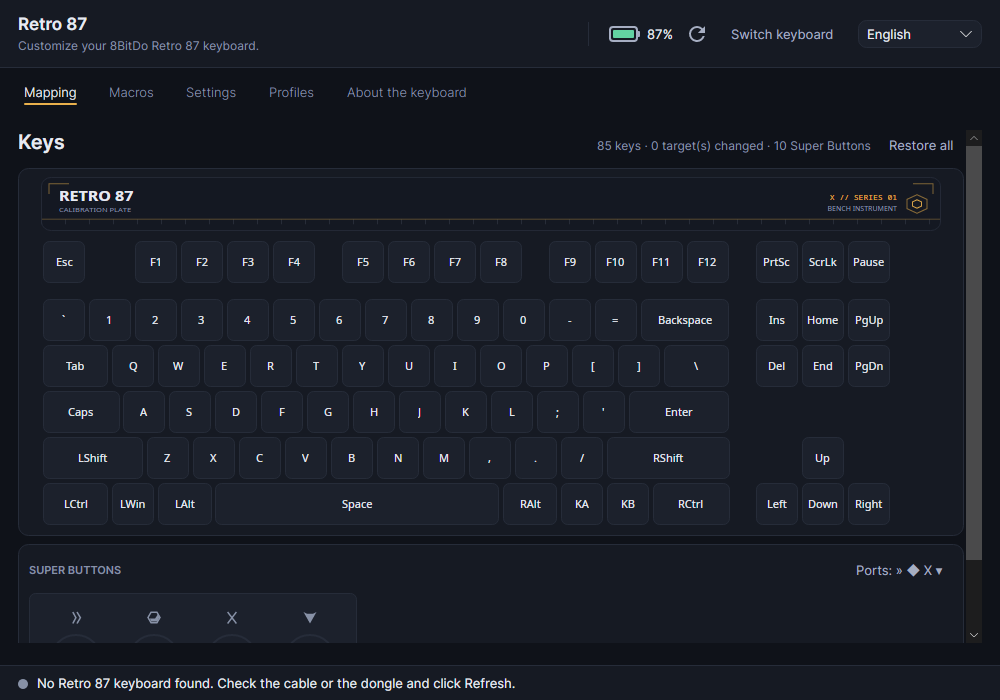

# Retro87

**Unofficial** configurator for the **8BitDo Retro 87 / Retro 87 "X"** keyboard on Windows and Linux.
Talks directly to the keyboard's HID interface, without Ultimate Software V2 or requiring Windows.

**Not affiliated with 8BitDo.** This is an independent, unofficial project. It is not endorsed
or sponsored by 8BitDo. 8BitDo and Retro 87 are trademarks of their respective owners, used here
only to say which keyboard the software works with.

> ⚠️ **AI disclosure — "vibe coded".** This project was developed **almost entirely by AI**
> (agents in OpenCode), under human direction. The code may contain errors, including protocol
> errors that affect the keyboard. Review it, back up your configuration, and use it at your own
> risk — do not treat this software as an authority on your hardware.
>
> Status: **v0.0.0 — experimental prototype**. Reading and writing have been validated on the
> device (Xbox family, including the 2.4 G dongle). In the Linux window, reading was validated
> with the real keyboard; writing from the window was not — see [Pending work](#pending-work).



## Features

- **Reads** the keyboard configuration: 95 mapping positions, macros, profile name, and
  configuration fields.
- **Remaps** any key to another key, a media key, or a mouse action, with a searchable
  selector and per-key restore.
- **Edits macros**: 8 slots with name, cycles, interval, and steps (press / release / wait).
- **Adjusts** volume (1–5) and Quick Setup (disable Win, Alt+Tab, Alt+F4) on the Xbox family;
  *special feature* on the JP family.
- **Identifies Super Buttons** by reading the keyboard's HID reports: shows the port (A/B/X/Y or
  » ◆ X ▾) and button, including media keys consumed by the desktop before reaching the window.
- **Saves local profiles** in JSON and makes an **automatic backup** before any write.
- **Checks** the published firmware version and only **notifies**. Never downloads or writes firmware.
- **Generates a read-only diagnostic report** in TOML, for requesting support without exposing
  the full configuration dump.

## Safety

The project rule is simple: **reading is unrestricted; writing is a deliberate act**. Since the
code was AI-generated and may contain errors, treat every write as risky and keep a backup.

1. Writing requires checking **"Allow writing to this keyboard"** for the current connection.
2. Before writing, the app saves a backup of the device's previous state.
3. Writes start from the configuration read and send only what changed.
4. After writing, the app reads the device again.
5. Bench probes have a `--plan` mode (only reads and displays frames) and are reversible.
6. **Firmware is never written** — this is a product promise, not just a technical limit.

## Devices

| Family | PIDs | Protocol | Status |
|---|---|---|---|
| JP | `0x5200`, `0x5201`, `0xFF08` | `JpProtocol` | reading/writing implemented |
| Xbox "X" | `0x2028` (cable), `0x202E` (dongle) | `XboxJpProtocol` | reading/writing **validated on the device** |

Per-operation details in [`docs/SUPPORT_MATRIX.md`](docs/SUPPORT_MATRIX.md).

## Requirements

- Windows 10/11 or Linux with `hidraw` and udev.
- [.NET 10 SDK](https://dotnet.microsoft.com/download/dotnet/10.0) to build (the app still targets .NET 8; Avalonia 12 needs the newer compiler).
- Retro 87 keyboard (VID `0x2DC8`) connected by cable or the 2.4 G dongle.

## Build and run

```bash
dotnet build src/Retro87/Retro87.csproj
dotnet run --project src/Retro87
```

Hardware-free tests run with `dotnet test`:

```bash
dotnet test tests/Retro87.Tests/Retro87.Tests.csproj
```

The binary is in `src/Retro87/bin/Debug/net8.0/`. To check without hardware:

```bash
./scripts/verify.sh          # Linux/macOS
pwsh ./scripts/verify.ps1    # Windows
```

Or directly through the DLL (required on Windows because `WinExe` has no console of its own):

```bash
dotnet src/Retro87/bin/Release/net8.0/Retro87.dll --selftest
dotnet src/Retro87/bin/Release/net8.0/Retro87.dll --version
dotnet src/Retro87/bin/Release/net8.0/Retro87.dll --help
```

## Linux: hidraw permissions (udev)

Install the rule included in [`packaging/linux/70-8bitdo.rules`](packaging/linux/70-8bitdo.rules):

```bash
sudo install -m 0644 packaging/linux/70-8bitdo.rules /etc/udev/rules.d/70-8bitdo.rules
sudo udevadm control --reload-rules
sudo udevadm trigger
```

Reconnect the keyboard and log out and back in. **The `70-` prefix matters**: `TAG+="uaccess"`
only becomes an ACL in systemd's `73-seat-late.rules`; a `99-*.rules` file applies the tag too
late and does not grant access. The rule also covers Bluetooth (`*:2DC8:*`).

If permissions are still missing, the file has a commented-out `MODE="0666"` fallback — it grants
broader access, so use it only for testing.

## CLI

| Command | Purpose |
|---|---|
| `Retro87` | opens the window |
| `--version`, `--help` | version and help |
| `--selftest` | hardware-free model/protocol checks |
| `--report [file.toml]` | **read-only** diagnostic report |
| `--make-icon [app.ico]` | generates the app icon |
| `--xbox-probe` | reads firmware, battery, and configuration summary (read-only) |
| `--xbox-input-probe [--seconds N]` | prints input reports from each HID collection (read-only) |
| `--xbox-super-listen [--seconds N]` | identifies Super Buttons from HID reports, with port and target (read-only) |
| `--xbox-wake [--plan]` | tests the wake handshake |
| `--xbox-link-test` | measures sleep after link loss (unplug/replug the dongle) |
| `--xbox-write-test [--plan]` | reversible mapping write test |
| `--xbox-super-test [--plan]` | reversible test of the 10 Super Buttons |
| `--xbox-macro-test [--plan]` | reversible macro test |
| `--xbox-config-test [--plan]` | reversible name/single-byte test |
| `--xbox-media-test [--plan]` | reversible media/mouse target test |
| `--xbox-ui-config-test [--plan]` | reversible test of the Settings tab fields |
| `--xbox-restore <file.bin>` | restores a 1532 B backup |

Always start with `--plan`. Write probes (`--xbox-*-test`) send real frames to the keyboard: they
back up first, read back, and undo their changes, but run them only on a keyboard you own and
only with `--plan` reviewed first.

## Repository structure

| Path | Contents |
|---|---|
| `src/Retro87/` | Avalonia/.NET 8 app |
| `src/Retro87/Models/` | tables, codecs, geometry, and models |
| `src/Retro87/Protocol/` | framing, commands, HID transport, and simulated devices |
| `src/Retro87/Services/` | device monitor, profiles, backup, firmware, and report |
| `src/Retro87/ViewModels/`, `Views/` | MVVM and interface |
| `tests/Retro87.Tests/` | xUnit tests (`dotnet test`) |
| `docs/` | protocol, support matrix, architecture, provenance, and release checklist |
| `packaging/` | udev rule and packaging material |
| `scripts/` | verification, guards, publishing, and CI |
| `local/` | research material (official app, decompiled files, captures, notes) — **ignored by Git** |

## Tests and CI

- `scripts/verify.sh` builds in Release, runs the self-test and xUnit tests (without hardware).
- `dotnet test tests/Retro87.Tests/Retro87.Tests.csproj` runs only the xUnit tests.
- `scripts/check_vendor_artifacts.sh` prevents vendor binaries/decompiled files from entering Git.
- `scripts/check_udev_rule.sh` validates the filename, `SUBSYSTEM`, and `TAG+="uaccess"`.
- `scripts/check_version.sh` keeps `VERSION` and the `.csproj` in sync.
- `scripts/check_spdx.sh` requires SPDX headers in C#, XAML, and script sources.
- GitHub Actions runs build + self-test + tests on Ubuntu and Windows, plus the guards.

## Packaging

```bash
./scripts/publish.sh linux-x64
./scripts/publish.sh win-x64
```

Generates a self-contained binary in `dist/<rid>/` and a `.tar.gz` with README, VERSION, CHANGELOG,
LICENSE, and, on Linux, the udev rule.

## Documentation

- [`DESIGN.md`](DESIGN.md) — visual system.
- [`docs/PROTOCOL.md`](docs/PROTOCOL.md) — HID protocol for the JP and Xbox families.
- [`docs/SUPPORT_MATRIX.md`](docs/SUPPORT_MATRIX.md) — what has been validated on hardware.
- [`docs/ARCHITECTURE.md`](docs/ARCHITECTURE.md) — layers, flows, and invariants.
- [`docs/PROVENANCE.md`](docs/PROVENANCE.md) — material origins and legal boundary.
- [`docs/RELEASE.md`](docs/RELEASE.md) — release checklist.

## Provenance and license

This is an **unofficial** project, unaffiliated with 8BitDo. The protocol was reverse-engineered
and is documented as interoperability notes; **vendor binaries, decompiled code, captures, and
firmware are not part of the repository** (see
[`docs/PROVENANCE.md`](docs/PROVENANCE.md)).

The code in this repository is licensed under the **GNU General Public License v3.0 or later**
(`GPL-3.0-or-later`); the full text is in [`LICENSE`](LICENSE). Choosing GPL keeps the project
compatible with the 8BitDo interoperability ecosystem (for example, `openbitdo`, also
GPL-3.0-or-later).

The license covers this repository's code and documentation. It does **not** change the origins
of the material documented in `docs/` — read [`docs/PROVENANCE.md`](docs/PROVENANCE.md) before
redistributing.

## Pending work

- Validate clicking **Write to keyboard** in the window with the real keyboard (the `WriteConfig`
  method has already been validated through the CLI).
- Test the udev rule's **Bluetooth** path.
- LED/theme (`cmd 0x0F`, 283 B) — outside v1.
- Macros: repeat/interval, triggering, and A2.

## Contributing

Read [`CONTRIBUTING.md`](CONTRIBUTING.md) before opening a change. For security flaws, use
[`SECURITY.md`](SECURITY.md) — do not open a public issue with details of device writes.
